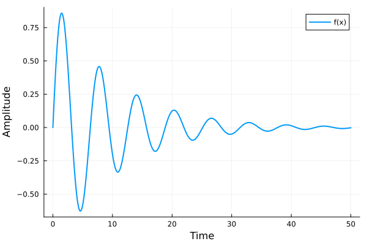

# juliatex: Julia inside LaTeX

Write Julia code inside your `.tex` and, when you compile, its results (text, values and plots) end up in the PDF.
With the `[md]` option you also get a `.md` with the same results, ready to be viewed on GitHub.

**Example:** [`analysis.tex`](analysis.tex) → [`analysis.md`](analysis.md) (rendered right here on GitHub) and [`analysis.pdf`](analysis.pdf).

[](analysis.md)

```latex
\usepackage[md]{juliatex}   % [md] is optional: also writes <document>.md

\begin{juliacode}           % shows the code and its output below it
f(x) = exp(-0.1x) * sin(x)
round.(f.(0:2:8), digits = 3)
\end{juliacode}

\begin{juliarun}            % only runs it (prepare data, save plots...)
using Plots
plot(0:0.1:50, f.(0:0.1:50)); savefig("resources/damped.pdf")
\end{juliarun}

\juliagraphics[width=0.7\linewidth]{resources/damped.pdf}   % the plot Julia saved
The maximum is \juliav{round(maximum(f.(0:0.1:50)), digits = 4)}.   % a value in the text
```

## Layout

| | |
|---|---|
| `analysis.tex`, `analysis.md`, `analysis.pdf` | The example: source and results |
| `resources/` | Files the example generates and links to (plots) |
| `juliatex/` | The package: `juliatex.sty`, its Lua and Julia parts, and the pandoc filter for `[md]` |
| `Project.toml` | The Julia environment of the example (only `Plots`) |
| `.latexmkrc` | LuaLaTeX with `-shell-escape`, and tells LaTeX where the package is |
| `nvim/` | Optional minimal Neovim setup |

## How it works

- All code shares a single Julia session, in document order.
- It runs in the environment of the project's `Project.toml` (here, only `Plots`), never in Julia's global environment.
  For another environment folder: the `JULIATEX_PROJECT` variable.
- Outputs are stored in `.juliatex/<document>/`: if the code did not change, Julia does not run again and compiling takes as long as plain LaTeX (~2 s).
- A background Julia server keeps the session and packages loaded (it shuts down by itself after 30 min idle): if you change block *k*, only blocks *k* onwards run.
- A Julia error is shown in red in the document, where the block is, and the other blocks keep running.
- pandoc writes the `.md` (a few tenths of a second) only on the last pass and only if something changed.
  Plots: GitHub does not show PDF inside a `.md`, so if there is an `x.svg` (or `x.png`) next to `x.pdf`, the `.md` uses that one.
  That is why the example calls `savefig` twice.

## Requirements

| | Windows | Linux |
|---|---|---|
| LaTeX with LuaLaTeX and latexmk | [TinyTeX](https://yihui.org/tinytex/) or TeX Live | TinyTeX or TeX Live (`texlive-luatex`, `latexmk`) |
| Julia ≥ 1.10 | `winget install --id JuliaLang.Juliaup` | `curl -fsSL https://install.julialang.org \| sh` |
| pandoc (only for `[md]`) | `winget install --id JohnMacFarlane.Pandoc` | `sudo apt install pandoc` (or your distribution's) |
| PDF viewer (optional) | `winget install --id SumatraPDF.SumatraPDF` | zathura |

With TinyTeX, the packages the example uses:

```sh
tlmgr install latexmk titling listings
```

`julia`, `pandoc`, `lualatex` and `latexmk` must be on the `PATH`.

## Usage

```sh
git clone https://github.com/ferrerama/juliaTex
cd juliaTex
julia --project=. -e "using Pkg; Pkg.instantiate()"   # first time only (Plots takes a few minutes)
latexmk analysis.tex
```

The `.latexmkrc` already asks for LuaLaTeX with `-shell-escape` (needed to launch Julia) and tells LaTeX the package is in `juliatex/`: nothing has to be installed system-wide.

For your own document, copy `juliatex/`, `.latexmkrc` and `Project.toml` (with the Julia packages you use) to its folder.

## Neovim (optional)

[`nvim/init.lua`](nvim/init.lua) is a minimal setup, independent of your own:

```sh
nvim -u nvim/init.lua analysis.tex
```

- The first time it downloads [lazy.nvim](https://github.com/folke/lazy.nvim), [vimtex](https://github.com/lervag/vimtex) and the nord theme into `nvim/.lazy/` (needs `git`).
- **F5** in a `.tex`: continuous build with latexmk and the PDF open in the viewer; every save updates the PDF and the `.md`.
  In a `.jl`: opens a Julia REPL with the file loaded.
- Julia code highlighted inside `juliacode`/`juliarun`, English spell checking.
- Viewer: SumatraPDF on Windows (looked up on the `PATH`, in the default install, or in the `SUMATRA` variable), zathura on Linux.

`chktexrc` (Windows) and `.chktexrc` (Linux) tell chktex that Julia code is not LaTeX text.

## License

MIT, see [LICENSE](LICENSE).
