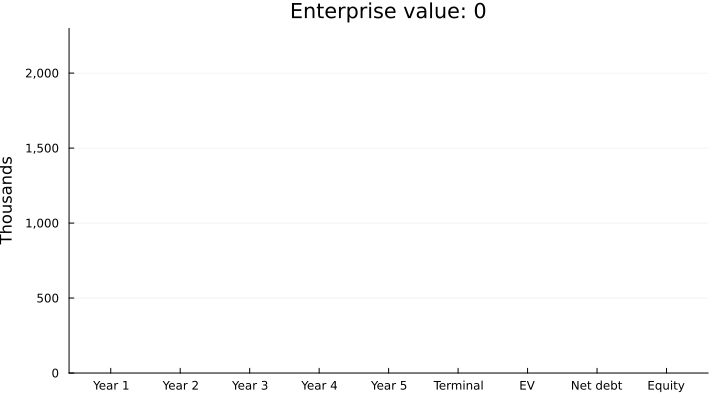

# juliatex: Julia inside LaTeX

[](https://github.com/ferrerama/juliaTex/actions/workflows/CI.yml)
[](https://opensource.org/licenses/MIT)
[](https://julialang.org)

Write Julia code inside your `.tex` and, when you compile, its results (text, values and plots) end up in the PDF.
With the `[md]` option you also get a `.md` with the same results, ready to be viewed on GitHub.

**Example:** a company valuation (cost of capital, DCF, sensitivity) with [CorporateFinance.jl](https://github.com/ferrerama/CorporateFinance.jl):
[`example/analysis.tex`](example/analysis.tex) → [`analysis.md`](example/analysis.md) (rendered right here on GitHub) and [`analysis.pdf`](example/analysis.pdf).

[](example/analysis.md)

```latex
\usepackage[md]{juliatex}   % [md] is optional: also writes <document>.md

\begin{juliacode}           % shows the code and its output below it
using CorporateFinance
fcf = [120_000, 135_000, 150_000, 160_000, 170_000]
r = dcf_valuation(fcf; wacc = 0.0959, g = 0.02)
\end{juliacode}

\begin{juliarun}            % only runs it (prepare data, save plots...)
using Plots
bar(1:5, fcf); savefig("resources/fcf.pdf")
\end{juliarun}

\juliagraphics[width=0.7\linewidth]{resources/fcf.pdf}   % the plot Julia saved
The enterprise value is \juliav{round(Int, r.enterprise_value)}.   % a value in the text
```

## Layout

| | |
|---|---|
| `juliatex/` | The package: `juliatex.sty`, its Lua and Julia parts, and the pandoc filter for `[md]` |
| `example/` | A complete example: `analysis.tex` and its results (`analysis.md`, `analysis.pdf`, plots in `resources/`) |
| `example/Project.toml` | The Julia environment of the example (`CorporateFinance` and `Plots`) |
| `example/.latexmkrc` | LuaLaTeX with `-shell-escape`, and tells LaTeX where the package is |
| `docs/reference.md` | Reference: options, environments, commands, caching, Markdown output, variables |
| `nvim/` | Optional minimal Neovim setup, with the Julia language server inside the `.tex` |
| `.github/workflows/CI.yml` | Compiles the example on every push (Linux and Windows) |

## How it works

- All code shares a single Julia session, in document order.
- It runs in the environment of the project's `Project.toml` (in the example, `CorporateFinance` and `Plots`), never in Julia's global environment.
  For another environment folder: the `JULIATEX_PROJECT` variable.
- Outputs are stored in `.juliatex/<document>/`: if the code did not change, Julia does not run again and compiling takes as long as plain LaTeX (~2 s).
- A background Julia server keeps the session and packages loaded (it shuts down by itself after 30 min idle): if you change block *k*, only blocks *k* onwards run.
- A Julia error is shown in red in the document, where the block is, and the other blocks keep running.
- pandoc writes the `.md` (a few tenths of a second) only on the last pass and only if something changed.
  Plots: GitHub does not show PDF inside a `.md`, so if there is an `x.svg` (or `x.png`) next to `x.pdf`, the `.md` uses that one.
  That is why the example calls `savefig` twice.

Every option, command and setting is described in the [reference](docs/reference.md).

## Requirements

| | Windows | Linux |
|---|---|---|
| LaTeX with LuaLaTeX and latexmk | [TinyTeX](https://yihui.org/tinytex/) or TeX Live | `sudo apt install texlive-luatex texlive-latex-extra latexmk` (or TinyTeX) |
| Julia ≥ 1.10 | `winget install --id JuliaLang.Juliaup` | `curl -fsSL https://install.julialang.org \| sh` |
| pandoc ≥ 3 (only for `[md]`) | `winget install --id JohnMacFarlane.Pandoc` | `sudo apt install pandoc` (Ubuntu 24.04 or later) |
| PDF viewer (optional) | `winget install --id SumatraPDF.SumatraPDF` | zathura |
| Neovim ≥ 0.11 and git (optional, for `nvim/`) | `winget install --id Neovim.Neovim` | the [official release](https://github.com/neovim/neovim/releases) (`apt` may ship an older one) |

With TinyTeX, the packages the example uses:

```sh
tlmgr install latexmk titling listings
```

`julia`, `pandoc`, `lualatex` and `latexmk` must be on the `PATH`.
With MiKTeX instead of TinyTeX, latexmk also needs Perl (for example [Strawberry Perl](https://strawberryperl.com/)).

## Usage

```sh
git clone https://github.com/ferrerama/juliaTex
cd juliaTex/example
julia --project=. -e "using Pkg; Pkg.instantiate()"   # first time only (Plots takes a few minutes)
latexmk analysis.tex
```

CorporateFinance.jl is not in the General registry yet: `Project.toml` points to its GitHub repository, pinned to the `v0.1.0` release (`[sources]`, Julia 1.11+).
On Julia 1.10, install it first with `julia --project=. -e "using Pkg; Pkg.add(url=\"https://github.com/ferrerama/CorporateFinance.jl\", rev=\"v0.1.0\")"`.

The `.latexmkrc` already asks for LuaLaTeX with `-shell-escape` (needed to launch Julia) and tells LaTeX the package is in `../juliatex/`: nothing has to be installed system-wide.

> [!WARNING]
> `-shell-escape` lets the document run programs on your computer, and the Julia code in a `.tex` runs with your user's permissions.
> Only compile documents you trust, as you would only run scripts you trust.

The CI workflow compiles the example from scratch on Linux and Windows, with Julia 1.10 (LTS) and the latest 1.x.

For your own document, start from a copy of `example/` and point the `TEXINPUTS` line of its `.latexmkrc` to wherever `juliatex/` is; list the Julia packages you use in `Project.toml`.
With the Neovim setup below, a lone `.tex` is enough.

## Neovim (optional)

[`nvim/init.lua`](nvim/init.lua) is a minimal setup, independent of your own:

```sh
cd example
nvim -u ../nvim/init.lua analysis.tex
```

- The first time it downloads [lazy.nvim](https://github.com/folke/lazy.nvim), [vimtex](https://github.com/lervag/vimtex), [no-neck-pain](https://github.com/shortcuts/no-neck-pain.nvim) and the nord theme into `nvim/.lazy/` (needs `git`).
- `.tex` and `.md` are edited as a page: 95 columns (an APA 7 line) on the left, with no frame or divider; code goes back to the full width.
  **Space ft** opens a terminal below the page, just as wide (full width outside it).
- **F5** in a `.tex`: continuous build with latexmk and the PDF open in the viewer; every save updates the PDF and the `.md`.
  Any folder works, with no `.latexmkrc`: F5 finds the package in `juliatex/`, uses LuaLaTeX with `-shell-escape`, and, if there is no `Project.toml` next to the `.tex` or above it, the Julia environment of `example/`.
  In a `.jl`: opens a Julia REPL with the file loaded.
- Julia code highlighted inside `juliacode`/`juliarun`, English spell checking.
- Julia language server ([LanguageServer.jl](https://github.com/julia-vscode/LanguageServer.jl)) in `.jl` files and **inside the `.tex`**: in `juliacode`, `juliarun` and `\juliav{...}`, errors such as `Missing reference: x` show up on their line, with completion (after `.`, or **Ctrl-Space**), hover (**K**) and go-to-definition (**Ctrl-]**).
  It needs **Julia 1.10**: `julia` if it is 1.10, or else `julia +1.10` (with juliaup: `juliaup add 1.10`); otherwise nvim warns and leaves it off.
  LanguageServer.jl 4 fails to start on Julia 1.11+, and version 6 turns off missing references by default.
  The first time it installs LanguageServer.jl into `nvim/lsp/` (a few minutes); it then takes about a minute to index the packages of the environment.
  Packages are resolved with the same environment F5 uses: the `Project.toml` next to the file or above it, or else the one of `example/`.
  For a `.tex` it writes a mirror of its Julia code, `<document>.juliatex.jl`, which it deletes when the `.tex` is closed.
- Viewer: SumatraPDF on Windows (looked up on the `PATH`, in the default install, or in the `SUMATRA` variable), zathura on Linux.

`juliatex/chktexrc` (Windows) and `juliatex/.chktexrc` (Linux) tell chktex that Julia code is not LaTeX text; the Neovim setup points `CHKTEXRC` there.

## License

MIT, see [LICENSE](LICENSE).
