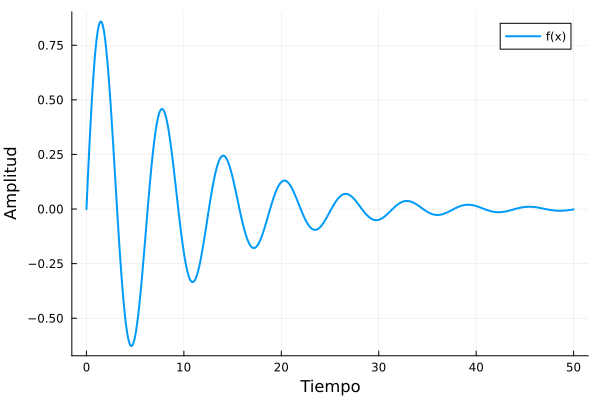

# Análisis de Datos Científicos

*Miguel Ferrera*

## Introducción al modelo

Analizamos una función trigonométrica amortiguada, definida por cada dato nuevo.
``` math
f(x) = e^{-0.1x} \sin(x).
```

## Simulación en Julia

Definimos la función y evaluamos algunos puntos:

``` julia
f(x) = exp(-0.1x) * sin(x)
x = 0:0.1:50
println("Puntos evaluados: ", length(x))
round.(f.(0:2:8), digits = 3)
```

```text
Puntos evaluados: 501
5-element Vector{Float64}:
  0.0
  0.744
 -0.507
 -0.153
  0.445
```

La gráfica se genera aparte, sin mostrar el código dependiente:



*Figura 1: Función amortiguada generada por Julia al compilar.*

Como se ve en la figura 1, la amplitud decrece exponencialmente. El máximo calculado es 0.8586.
