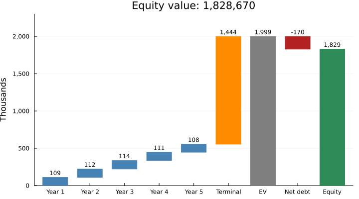

# Company Valuation with CorporateFinance.jl

*Miguel Ferrera*

## Cost of capital

The target company has no traded shares, so its beta comes from a comparable company: we unlever the comparable’s beta and relever it to the target’s capital structure. The cost of equity follows from CAPM with a country risk premium, and the discount rate is the WACC.

``` julia
using CorporateFinance
bu = unlever_beta(beta = 1.3, tax = 0.30, E = 500_000, D = 500_000)
bl = relever_beta(beta = bu, tax = 0.30, E = 800_000, D = 200_000)
ke = capm(rf = 0.04, beta = bl, erp = 0.055, crp = 0.02)
w = wacc(ke = ke, kd = 0.06, tax = 0.30, E = 800_000, D = 200_000)
map(v -> round(v, digits = 4), (beta_unlevered = bu, beta = bl, ke = ke, wacc = w))
```

```text
(beta_unlevered = 0.7647, beta = 0.8985, ke = 0.1094, wacc = 0.0959)
```

The cost of equity is 10.94 % and the WACC is 9.59 %.

## Discounted cash flows

Five years of free cash flow are projected, followed by a Gordon terminal value with 2 % long-term growth. Net debt (debt minus cash) takes us from the enterprise value to the equity value.

``` julia
fcf = [120_000, 135_000, 150_000, 160_000, 170_000]
r = dcf_valuation(fcf; wacc = w, g = 0.02)
equity = equity_value(ev = r.enterprise_value, debt = 200_000, cash = 30_000)
map(v -> round(Int, v), (pv_fcf = r.pv_fcf, pv_terminal = r.pv_terminal,
                         enterprise_value = r.enterprise_value, equity = equity))
```

```text
(pv_fcf = 554292, pv_terminal = 1444378, enterprise_value = 1998670, equity = 1828670)
```



*Figure 1: Valuation bridge, in thousands, generated by Julia at compile time.*

As figure 1 shows, the enterprise value is 1,998,670 and the equity value is 1,828,670. The terminal value accounts for 72 % of the enterprise value, which is typical of a five-year forecast.

## Sensitivity

Because the terminal value weighs so much, the result depends on the discount rate and on the long-term growth. The table shows the enterprise value, in thousands, for WACC one point below and above the base case (rows) and for growth between 1.5 % and 2.5 % (columns).

``` julia
waccs = round.(w .+ (-0.01:0.01:0.01), digits = 4)
gs = [0.015, 0.02, 0.025]
round.(Int, dcf_sensitivity(fcf; waccs, gs) ./ 1000)
```

```text
3×3 Matrix{Int64}:
 2182  2312  2465
 1904  2000  2109
 1687  1760  1842
```
